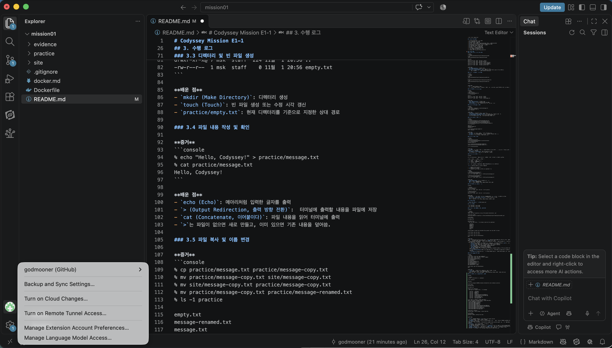

# Codyssey Mission E1-1

## 1. 실행 환경

- OS: macOS 26.4.1 (Apple Silicon, arm64)
- Shell: zsh
- Terminal: macOS Terminal
- Docker: 29.8.2 (OrbStack)
- Git: 2.50.1 (Apple Git)

## 2. 수행 체크리스트

- [x] 터미널 기본 조작 및 경로 확인
- [x] 파일·디렉터리 권한 실습
- [x] Docker 설치 및 동작 점검
- [x] 이미지 다운로드·목록, 컨테이너 실행·중지·목록, 로그·리소스 확인
- [x] hello-world 및 Ubuntu 컨테이너 실행(attach/exec 비교)
- [x] Dockerfile 작성 및 커스텀 이미지 빌드·실행
- [x] 포트 매핑 및 웹 서버 접속 확인
- [x] 바인드 마운트 변경 전·후 확인
- [x] Docker 볼륨 데이터 영속성 확인
- [x] Git 설정 및 GitHub·VS Code 연동
- [x] 트러블슈팅 2건 이상 기록
- [ ] 실습 증거 링크·재현 절차·민감정보 점검

## 3. 수행 로그

### 3.1 현재 경로 및 파일 목록 확인

**증거**
```console
% cd /Users/msk/Desktop/Projects/Codyssey/mission01
% pwd
/Users/msk/Desktop/Projects/Codyssey/mission01

% ls -la
total 24
drwxr-xr-x@ 6 msk  staff   192 11월  1 20:32 .
drwxr-xr-x  6 msk  staff   192 10월 30 20:56 ..
-rw-r--r--@ 1 msk  staff  6148 11월  1 20:28 .DS_Store
drwxr-xr-x  2 msk  staff    64 10월 30 20:57 evidence
-rw-r--r--@ 1 msk  staff   106 11월  1 20:32 README.md
drwxr-xr-x  2 msk  staff    64 10월 30 20:57 site
```

**배운 점**
- `cd (Change Directory)`: 디렉터리 이동
- `pwd (Print Working Directory)`: 현재 작업 경로 출력
- `ls (List) -l (Long format) -a (All)`: 숨김 파일(-a)을 포함한 상세(-l) 목록 확인(ls)
- `.`은 현재 디렉터리, `..`은 상위 디렉터리를 의미한다.

### 3.2 절대 경로와 상대 경로 비교

**증거**
```console
% cd site
% pwd
/Users/msk/Desktop/Projects/Codyssey/mission01/site

% cd ..
% cd /Users/msk/Desktop/Projects/Codyssey/mission01/site
% pwd
/Users/msk/Desktop/Projects/Codyssey/mission01/site

% cd ..
```

**배운 점**
- `cd ..` : 상위 디렉터리로 이동
- 절대 경로는 최상위 디렉터리부터 위치를 지정하고, 상대 경로는 현재 작업 디렉터리를 기준으로 위치를 지정한다.

### 3.3 디렉터리 및 빈 파일 생성

**증거**
```console
% mkdir practice
% touch practice/empty.txt
% ls -la practice

total 0
drwxr-xr-x  3 msk  staff   96 11월  1 20:56 .
drwxr-xr-x@ 7 msk  staff  224 11월  1 20:56 ..
-rw-r--r--  1 msk  staff    0 11월  1 20:56 empty.txt
```

**배운 점**
- `mkdir (Make Directory)`: 디렉터리 생성
- `touch (Touch)`: 빈 파일 생성 또는 수정 시각 갱신
- `practice/empty.txt`: 현재 디렉터리를 기준으로 지정한 상대 경로

### 3.4 파일 내용 작성 및 확인

**증거**
```console
% echo "Hello, Codyssey!" > practice/message.txt
% cat practice/message.txt
Hello, Codyssey!
```

**배운 점**
- `echo (Echo)`: 메아리처럼 입력한 글자를 출력
- `> (Output Redirection, 출력 방향 전환)`:  터미널에 출력할 내용을 파일에 저장
- `cat (Concatenate, 이어붙이다)`: 파일 내용을 읽어 터미널에 출력
- `>`는 파일이 없으면 새로 만들고, 이미 있으면 기존 내용을 덮어씀.

### 3.5 파일 복사 및 이름 변경

**증거**
```console
% cp practice/message.txt practice/message-copy.txt
% mv practice/message-copy.txt site/message-copy.txt
% mv site/message-copy.txt practice/message-copy.txt 
% mv practice/message-copy.txt practice/message-renamed.txt 
% ls -1 practice

empty.txt
message-renamed.txt
message.txt

% cat practice/message-renamed.txt
Hello, Codyssey
```

**배운 점**
- `cp (Copy)`: 파일 복사. 원본을 유지하면서 복사본을 생성
- `mv (Move)`: 파일 이동 또는 이름 변경. 같은 폴더에서 사용하면 이름 변경
- `ls (List) -1`: 파일 목록을 한 줄에 하나씩 출력

### 3.6 파일 이동 및 삭제

**증거**
```console
% mkdir practice/archive
% mv practice/message-renamed.txt practice/archive/
% ls -1 practice/archive
message-renamed.txt

% rm -i practice/archive/message-renamed.txt
remove practice/archive/message-renamed.txt? y

% ls -1 practice/archive
```

**배운 점**
- `mv (Move)`: 파일 이동 및 이름 변경. 다른 디렉터리로 파일을 이동할 때 대상 경로를 지정한다. 끝의 `/`는 디렉터리를 나타내는 선택적 표기이다.
- `rm (Remove) -i (Interactive)`: 삭제 전 확인 후 파일 삭제
- `rm`으로 삭제한 파일은 일반적으로 휴지통을 거치지 않는다.

### 3.7 파일 권한 확인 및 변경

**개념**

파일 권한(Permission)은 누가 파일을 읽고, 수정하고, 실행할 수 있는지를 정하는 규칙이다.

| 권한  | 영어      | 의미    | 숫자  |
| --- | ------- | ----- | --- |
| `r` | Read    | 읽기    | 4   |
| `w` | Write   | 쓰기·수정 | 2   |
| `x` | Execute | 실행    | 1   |

권한은 **소유자(User), 그룹(Group), 기타 사용자(Others)** 순서로 설정한다.

`ls -l` 출력의 첫 문자는 파일 종류를 나타낸다.

- `-` (Regular File): 일반 파일
- `d` (Directory): 디렉터리
- `l` (Symbolic Link): 다른 파일이나 경로를 가리키는 링크

**증거**
```console
% chmod 600 practice/message.txt
% ls -l practice/message.txt
-rw-------  1 msk  staff  16 11월  1 20:59 practice/message.txt

% chmod 644 practice/message.txt
% ls -l practice/message.txt
-rw-r--r--  1 msk  staff  16 11월  1 20:59 practice/message.txt
```

**배운 점**
- `chmod (Change Mode)`: 파일 및 디렉터리 권한 변경
- `600`: 소유자만 읽기·쓰기 가능
- `644`: 소유자는 읽기·쓰기, 그룹과 기타 사용자는 읽기만 가능

### 3.8 디렉터리 권한 확인 및 변경

**증거**

```console
% chmod 700 practice
% ls -ld practice
drwx------  6 msk  staff  192 11월  1 21:17 practice

% chmod 755 practice
% ls -ld practice
drwxr-xr-x  6 msk  staff  192 11월  1 21:17 practice
```

**배운 점**
- 디렉터리의 `r`은 목록 읽기, `w`는 파일 생성·삭제·이름 변경, `x`는 내부 접근·탐색 권한이다.
- `ls -ld (List - Long format - Directory)`: 디렉터리 자체의 권한 확인
- `700`: 소유자만 모든 권한 보유
- `755`: 소유자는 모든 권한, 그룹과 기타 사용자는 읽기·접근 가능

## 4. Docker 실습

- [Docker 실습 기록 및 검증 결과](docker.md)

## 5. Git 설정 및 GitHub·VS Code 연동

### 5.1 Git 저장소 초기화 및 현재 설정 확인

**증거**

```console
% git status
fatal: not a git repository (or any of the parent directories): .git

% git init -b main
Initialized empty Git repository in /Users/msk/Desktop/Projects/Codyssey/mission01/.git/

% git status
On branch main

No commits yet

Untracked files:
  (use "git add <file>..." to include in what will be committed)

	.DS_Store
	Dockerfile
	README.md
	docker.md
	evidence/
	practice/
	site/

nothing added to commit but untracked files present (use "git add" to track)

% git config --get user.name

% git config --get user.email

% git config --get init.defaultBranch
main
```

**배운 점**
- `Git` 는 프로젝트 파일이 어떻게 바뀌었는지 선택한 시점마다 이력을 남기는 도구이다. 단, 이력은 자동으로 저장되는 것이 아니고, 저장 명령을 내려야 기록이 남는다. 이를 `Commit` 이라 한다.
-  개발을 하다보면 기존 작업을 유지하면서 새로운 아이디어를 시험해보고 싶을 수 있는데, 이 때 새로운 가지 `Branch` 를 만들어 별도로 진행 할 수 있다.
- `git init`(Initialize: 저장소 초기화): 현재 폴더에 Git 관리용 숨김 디렉터리인 `.git`을 만든다.
- `-b main`(Branch: 초기 브랜치 지정): 첫 브랜치 이름을 main으로 정한다.
- `git status`(상태 확인): 현재 브랜치와 파일의 관리·변경 상태를 확인한다.
- `git config`(설정 관리): Git의 설정을 지정하거나 확인한다.
- `--get`(설정값 조회): 지정한 Git 설정을 확인한다.
- `user.name`(작성자 이름): 커밋에 표시할 이름이다. 
- `user.email`(작성자 이메일): 커밋에 남길 이메일이다. GitHub에 등록·인증된 이메일을 사용하면 커밋을 계정과 연결할 수 있다.
- `--get init.defaultBranch`(기본 브랜치 설정 조회): 새 저장소의 기본 브랜치가 main으로 설정되어 있음을 확인한다.
- `No commits yet`(아직 커밋 없음): 변경 내용을 하나의 이력으로 저장하는 커밋을 아직 만들지 않았다.

### 5.2 Git 작성자 정보 설정

**증거**
```console
% git config --local user.name "godmooner"
% git config --local user.email "[이메일 마스킹]"
% git config --local --list
core.repositoryformatversion=0
core.filemode=true
core.bare=false
core.logallrefupdates=true
core.ignorecase=true
core.precomposeunicode=true
user.name=godmooner
user.email=[이메일 마스킹]

% git config --get init.defaultBranch
main
```

**배운 점**
- `--local`(현재 저장소에 적용): 설정을 현재 미션 저장소에 저장한다.
- `--list`(설정 목록 출력): 저장된 설정을 조회한다. 
- 작성자 정보 설정은 커밋에 남길 신원을 지정하는 작업이며, GitHub 로그인은 별도로 수행한다.

### 5.3 불필요한 파일 제외와 첫 커밋 만들기

**증거**

```console
% printf '\n.DS_Store\n' >> .gitignore

% cat .gitignore

.DS_Store

% git add .gitignore README.md docker.md Dockerfile site/ evidence/ practice/

% git status
On branch main

No commits yet

Changes to be committed:
  (use "git rm --cached <file>..." to unstage)

	new file:   .gitignore
	new file:   Dockerfile
	new file:   README.md
	new file:   docker.md
	new file:   evidence/Docker6-4-web-8080.png
	new file:   evidence/Docker7-1-bind-8081.png
	new file:   practice/empty.txt
	new file:   practice/message.txt
	new file:   site/index.html

% git commit -m "터미널 및 Docker 실습 기록"
[main (root-commit) c6c2180] 터미널 및 Docker 실습 기록
 9 files changed, 855 insertions(+)
 create mode 100644 .gitignore
 create mode 100644 Dockerfile
 create mode 100644 README.md
 create mode 100644 docker.md
 create mode 100644 evidence/Docker6-4-web-8080.png
 create mode 100644 evidence/Docker7-1-bind-8081.png
 create mode 100644 practice/empty.txt
 create mode 100755 practice/message.txt
 create mode 100644 site/index.html

% git log -1 --oneline
c6c2180 (HEAD -> main) 터미널 및 Docker 실습 기록

% git status
On branch main
nothing to commit, working tree clean
```

**배운 점**

- `printf`: 줄바꿈을 나타내는 `\n`을 사용해 제외 규칙을 출력한다.
- `>>`: 기존 내용을 유지하면서 내용을 덧붙인다.
- `.gitignore`: 아직 추적하지 않는 파일 중 Git 기록에서 제외할 대상을 지정한다. 이번에는 macOS의 폴더 표시 정보 파일인 .DS_Store를 제외했다.
- `git add`: 지정한 파일의 현재 내용을 스테이징 영역에 담는다. 스테이징 영역은 다음 저장 지점에 넣을 내용을 고르는 준비 공간이다.
- `git commit`: 준비한 내용을 하나의 변경 이력으로 저장한다.
- `-m`(Message): 커밋의 설명을 지정한다.
- `git log`(커밋 이력 조회), `-1`(최근 한 개), `--oneline`(한 줄 표시): 가장 최근 커밋을 간단히 확인한다.
- `c6c2180`은 이번 커밋의 짧은 식별 번호이고, `HEAD -> main`은 현재 main 브랜치의 해당 커밋을 가리킨다.
- `working tree clean`은 현재 작업 파일과 Git이 기록한 상태 사이에 남은 변경이 없다는 뜻이다.
- 이번 커밋은 내 컴퓨터에 저장한 이력이며, GitHub 업로드는 별도로 진행한다.

### 5.4 VS Code의 GitHub 인증 및 원격 저장소 연결

**증거**

- GitHub 저장소: https://github.com/godmooner/mission01
- 저장소 공개 범위: Public
- 터미널 업로드 과정에서 비밀번호 인증 오류가 발생했다.
- VS Code에서 Git: Push를 실행하고 GitHub 인증을 진행한 뒤 연결 상태를 확인했다.

```console
% git branch -vv
* main c6c2180 [origin/main] 터미널 및 Docker 실습 기록

% git status
On branch main
Your branch is up to date with 'origin/main'.

Changes not staged for commit:
  (use "git add <file>..." to update what will be committed)
  (use "git restore <file>..." to discard changes in working directory)

	modified:   README.md

no changes added to commit (use "git add" and/or "git commit -a")
```



**배운 점**

- `git remote add origin 주소`(원격 저장소 연결 추가): GitHub 저장소 주소를 origin이라는 이름으로 등록한다.
- `git push`(커밋 업로드): 로컬에 저장한 커밋을 원격 저장소에 보낸다.
- `-u`(Set Upstream): 로컬 브랜치와 원격 브랜치의 기본 연결을 설정한다.
- VS Code의 `Git: Push`(커밋 업로드): 편집기에서 원격 저장소로 업로드를 실행한다.
- `git branch -vv`(브랜치 상세 조회): 현재 커밋과 연결된 원격 브랜치를 확인한다.
- `git status`(작업 상태 확인): 원격 브랜치와의 상태 및 커밋하지 않은 변경을 확인한다.
- `[origin/main]`은 로컬 main이 원격 저장소 origin의 main 브랜치와 연결됐다는 뜻이다.
- `up to date`는 로컬 커밋이 현재 확인된 원격 브랜치와 일치한다는 뜻이다.
- GitHub 계정 비밀번호는 HTTPS 방식의 Git 업로드 인증에 사용할 수 없어, VS Code의 GitHub 인증으로 진행했다.
- 파일을 수정하고 저장하는 것, 커밋하는 것, GitHub에 업로드하는 것은 각각 별도 작업이다. 아직 커밋하지 않은 README 수정은 이번 업로드에 포함되지 않았다.

## 6. 트러블슈팅

### 6.1 볼륨 실습 중 컨테이너 이름 충돌

- **문제:** 새 컨테이너를 실행하려 했으나 e1-vol-2라는 이름이 이미 사용 중이라는 오류가 발생했다.
- **원인 가설:** 앞선 실습에서 만든 컨테이너가 종료된 뒤에도 남아 있어 같은 이름을 사용할 수 없는 것으로 판단했다.
- **확인:** 오류 메시지에서 해당 이름을 사용하는 기존 컨테이너의 ID를 확인했다.

```text
Conflict. The container name "/e1-vol-2" is already in use
```

- **해결/대안:** 컨테이너 이름을 직접 지정하지 않고 같은 볼륨을 연결해 파일을 읽는 방식으로 진행했다. 확인용 컨테이너에는 `--rm`(종료 후 자동 삭제)을 사용해 컨테이너가 남지 않도록 했다.
- **배운 점:** 종료된 컨테이너도 삭제 전까지 이름을 유지한다. 볼륨과 컨테이너는 별도로 관리된다.

### 6.2 GitHub 업로드 인증 실패

- **문제:** `git push`(커밋 업로드) 실행 중 인증 오류가 발생했다.
- **원인 가설:** GitHub 계정 비밀번호를 Git 업로드 인증에 사용할 수 없기 때문으로 판단했다.
- **확인:** 오류 메시지에서 비밀번호 인증이 지원되지 않음을 확인했다.

```text
remote: Invalid username or token. Password authentication is not supported for Git operations.
fatal: Authentication failed
```

- **해결:** VS Code의 `Git: Push`(커밋 업로드)에서 GitHub 인증을 진행해 업로드했다. 이후 원격 브랜치 연결과 동기화 상태를 확인했다.

```console
% git branch -vv
* main c6c2180 [origin/main] 터미널 및 Docker 실습 기록

% git status
On branch main
Your branch is up to date with 'origin/main'.
[이하 커밋하지 않은 README 변경 표시 생략]
```

- **배운 점:** Git 작성자 정보 설정, GitHub 웹 로그인, Git 업로드 인증은 각각 역할이 다르다. 커밋하지 않은 파일 수정은 Push에 포함되지 않는다.
