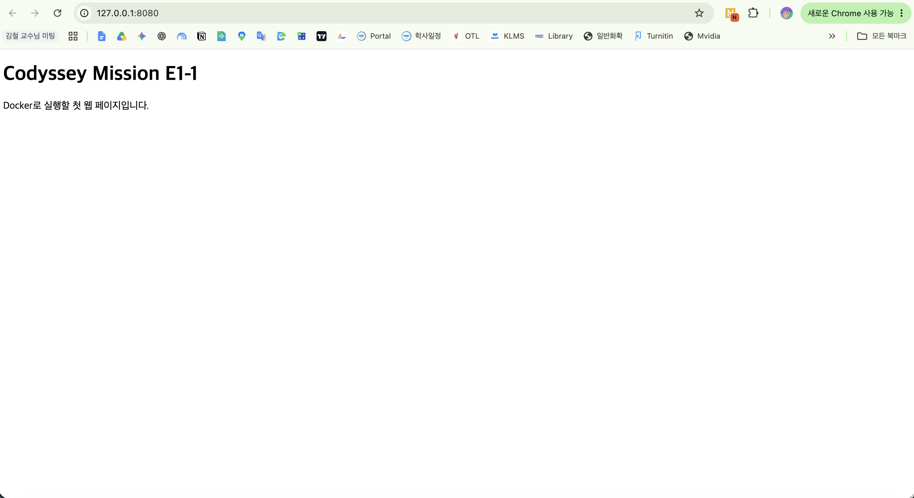
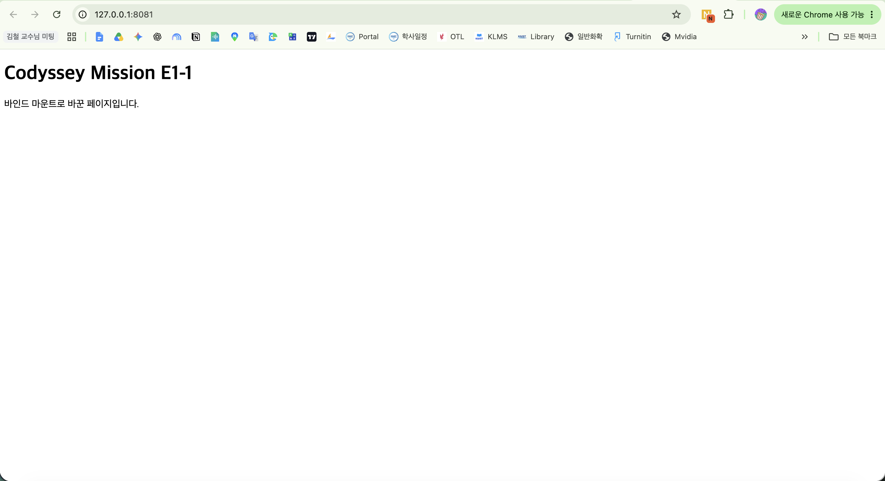

### 4.1 Docker 설치 및 기본 점검

**증거**

```console
% docker --version
Docker version 29.8.2, build 7fc2dff

% docker info
Client:
 Version: 29.8.2
 Context: orbstack

Server:
 Containers: 0
 Images: 0
 Server Version: 29.8.2
 Operating System: OrbStack
 OSType: linux
 Architecture: aarch64
[중략]
WARNING: DOCKER_INSECURE_NO_IPTABLES_RAW is set
```

**배운 점**
- `docker --version`: Docker 설치 버전 확인
- `docker info : Docker 엔진 연결 및 실행 상태 확인
- Client는 터미널에서 `docker` 명령어를 전달하는 쪽 , Server는 명령을 받아 실제 컨테이너를 생성하고 실행하는 쪽이다.

### 5.1 Docker 이미지 다운로드 및 목록 확인

**증거**
```
% docker pull hello-world
Using default tag: latest
latest: Pulling from library/hello-world
58dee6a49ef1: Pull complete 
c3bdf82c34d1: Download complete 
Digest: sha256:c567b231f65614688711a75f31518a064258a51d442117a3e771a3a8fdba78ef
Status: Downloaded newer image for hello-world:latest
docker.io/library/hello-world:latest

% docker images
IMAGE                ID             DISK USAGE   CONTENT SIZE   EXTRA
hello-world:latest   c567b231f656       18.5kB         10.3kB   
```

**배운 점**
- `docker pull : 이미지 다운로드
- `docker images : 로컬 이미지 목록 확인
- 이미지는 컨테이너 실행을 위한 기반이며, 하나의 이미지로 여러 컨테이너를 생성할 수 있다.

### 5.2 첫 Docker 컨테이너 실행

**증거**
```
% docker run --name e1-hello hello-world
Hello from Docker!
This message shows that your installation appears to be working correctly.

To generate this message, Docker took the following steps:
 1. The Docker client contacted the Docker daemon.
 2. The Docker daemon pulled the "hello-world" image from the Docker Hub.
    (arm64v8)
 3. The Docker daemon created a new container from that image which runs the
    executable that produces the output you are currently reading.
 4. The Docker daemon streamed that output to the Docker client, which sent it
    to your terminal.

To try something more ambitious, you can run an Ubuntu container with:
 $ docker run -it ubuntu bash

Share images, automate workflows, and more with a free Docker ID:
 https://hub.docker.com/

For more examples and ideas, visit:
 https://docs.docker.com/get-started/


% docker ps -a
CONTAINER ID   IMAGE         COMMAND    CREATED         
STATUS                     PORTS     NAMES

f96d554a47b7   hello-world   "/hello"   5 minutes ago   
Exited (0) 5 minutes ago             e1-hello
```

**배운 점**
- `docker run : 이미지로 컨테이너 생성 및 실행
- `--name`: 컨테이너 이름 지정
- `docker ps (Process Status) -a (All)`: 종료된 컨테이너를 포함한(-a) 컨테이너 목록 확인(ps)
- `Exited (0)`:  정상적으로 작업이 종료된 컨테이너의 상태 표시

### 5.3 컨테이너 실행 상태 확인

**증거**
```
% docker ps
CONTAINER ID   IMAGE     COMMAND   CREATED   STATUS    PORTS     NAMES

% docker ps -a
CONTAINER ID   IMAGE         COMMAND    CREATED         
STATUS                     PORTS     NAMES

f96d554a47b7   hello-world   "/hello"   5 minutes ago   
Exited (0) 5 minutes ago             e1-hello

% docker images
IMAGE                ID             DISK USAGE   CONTENT SIZE   EXTRA
hello-world:latest   c567b231f656       18.5kB         10.3kB    U 
```

**배운 점**
- `docker ps (Process Status)`: 실행 중인 컨테이너 목록 확인
- `docker ps -a (All)`: 종료된 컨테이너를 포함한 전체 목록 확인
- 이미지와 컨테이너는 독립적이며, 컨테이너가 종료되어도 이미지와 컨테이너 기록은 남는다.

### 5.4 컨테이너 로그 확인

**증거**

```
% docker logs e1-hello
Hello from Docker!
This message shows that your installation appears to be working correctly.

To generate this message, Docker took the following steps:
 1. The Docker client contacted the Docker daemon.
 2. The Docker daemon pulled the "hello-world" image from the Docker Hub.
    (arm64v8)
 3. The Docker daemon created a new container from that image which runs the
    executable that produces the output you are currently reading.
 4. The Docker daemon streamed that output to the Docker client, which sent it
    to your terminal.

To try something more ambitious, you can run an Ubuntu container with:
 $ docker run -it ubuntu bash

Share images, automate workflows, and more with a free Docker ID:
 https://hub.docker.com/

For more examples and ideas, visit:
 https://docs.docker.com/get-started/
```

**배운 점**

- `docker logs e1-hello`: e1-hello(hello-world 에 붙인 이름) 컨테이너가 남긴 출력 기록(logs)을 확인한다.
- 컨테이너가 종료되어도 삭제되지 않았다면 남아 있는 로그를 조회할 수 있다.

### 5.5 Ubuntu 컨테이너 실행 및 내부 명령

**증거**

```console
 % docker run -it --name ubuntu ubuntu:24.04 bash
Unable to find image 'ubuntu:24.04' locally
24.04: Pulling from library/ubuntu
e2d2bb84d022: Pull complete 
2238dc1b4376: Download complete 
Digest: sha256:fe81560990fae86dc4743202b2cb4d3df98d0bcf949173cecef15ce1127ef852
Status: Downloaded newer image for ubuntu:24.04

root@c6567a53e40e:/# pwd
/
root@c6567a53e40e:/# ls
bin  boot  dev  etc  home  lib  media  mnt  opt  proc  root  run  sbin  srv  sys  tmp  usr  var
root@c6567a53e40e:/# echo "Hello from Ubuntu"
Hello from Ubuntu
root@c6567a53e40e:/# exit
exit

% docker ps -a --filter name=ubuntu   
CONTAINER ID   IMAGE          COMMAND   CREATED          STATUS                      PORTS     NAMES
c6567a53e40e   ubuntu:24.04   "bash"    11 minutes ago   Exited (0) 10 minutes ago             ubuntu

```

**배운 점**

- `-i`(Interactive) : 나의 입력을 받을 수 있게함. 없으면 마치 키보드를 연결하지 않은 상태
- `-t` (TTY, Teletype) : 터미널 환경처럼 작업할 수 있게 도와줌.
- `ubuntu:24.04` :  ubuntu 뒤의 숫자는 태그 (여기서는 버전을 의미)
- `bash (Bourne Again SHell` : 입력한 명령을 받아 처리하는 프로그램. 비슷한 예시로 `zsh`, `sh` 등이 있음.
- `exit`(셸 종료): bash를 끝내고 맥 터미널로 돌아온다.
- `docker ps -a --filter name=ubuntu`(전체 컨테이너 중 이름으로 조회): 종료 상태를 확인한다.

### 5.6 기존 컨테이너 재시작 및 연결·종료 비교

**증거**

기존 컨테이너를 다시 시작하고 입력·출력을 연결했다.

```console
% docker start -ai ubuntu
root@c6567a53e40e:/#
```

Control+P → Q를 눌러 연결만 끊은 뒤, 맥 터미널에서 상태를 확인했다.

```console
% docker ps --filter name=ubuntu
CONTAINER ID   IMAGE          COMMAND   CREATED          STATUS          PORTS   NAMES
c6567a53e40e   ubuntu:24.04   "bash"    42 minutes ago   Up 12 minutes           ubuntu
```

실행 중인 컨테이너에서 새 Bash를 실행하고, 그 Bash를 종료한 뒤 상태를 다시 확인했다.

```console
% docker exec -it ubuntu bash
root@c6567a53e40e:/# exit
exit

% docker ps --filter name=ubuntu
CONTAINER ID   IMAGE          COMMAND   CREATED       STATUS       PORTS   NAMES
c6567a53e40e   ubuntu:24.04   "bash"    2 hours ago   Up 2 hours           ubuntu
```

**배운 점**

- `docker start`(기존 컨테이너 시작): 이미 생성된 컨테이너를 기존 설정으로 다시 실행한다.
- `-a`(Attach: 출력 연결): 컨테이너의 출력을 현재 터미널에 연결한다.
- `-t` 는 컨테이를 생성할 때 한번만 연결하면 되므로 다시 실행하지 않았다. 
- Control+P → Q(분리): 주 프로그램을 종료하지 않고 터미널 연결만 끊는다.
- `docker exec`(Execute: 추가 명령 실행): 실행 중인 컨테이너 안에서 별도의 프로그램을 실행한다.
- 추가 Bash를 종료(exit)해도 주 Bash가 살아 있으면 컨테이너는 계속 실행된다.


### 5.7 컨테이너 리소스 사용량 확인

**증거**

```console
% docker stats --no-stream ubuntu
CONTAINER ID   NAME     CPU %   MEM USAGE / LIMIT     MEM %   NET I/O          BLOCK I/O      PIDS
c6567a53e40e   ubuntu   0.00%   1.449MiB / 7.816GiB   0.02%   1.13kB / 126B   12.1MB / 0B    1
```

**배운 점**

- `docker stats`(Statistics: 자원 사용 통계 조회): 실행 중인 컨테이너의 CPU·메모리 등 사용량을 확인한다.
- `--no-stream`(연속 갱신 해제): 통계를 한 번만 출력하고 명령을 끝낸다.
- CPU 사용률은 0.00%, 메모리 사용량은 1.449MiB로 관찰됐다. 컨테이너가 실행 중이어도 대기 상태에서는 자원을 적게 사용할 수 있다.

### 5.8 컨테이너 중지 및 상태 확인

**증거**
```console
% docker stop ubuntu
ubuntu

% docker ps -a
CONTAINER ID   IMAGE          COMMAND   CREATED        STATUS                       PORTS   NAMES
c6567a53e40e   ubuntu:24.04   "bash"    3 hours ago    Exited (137) 3 seconds ago           ubuntu
f96d554a47b7   hello-world    "/hello"  31 hours ago   Exited (0) 31 hours ago              e1-hello
```

**배운 점**
- `docker stop ubuntu`(컨테이너 중지): ubuntu 컨테이너의 주 프로그램에 종료를 요청한다. 제한 시간 안에 종료되지 않으면 강제 종료한다.
- `Exited (137)`은 강제 종료 신호인 SIGKILL로 종료됐음을 나타낸다. 이번에는 중지 요청 이후 강제 종료됐을 가능성이 있다.
- 컨테이너 중지와 삭제는 다르다. 중지된 컨테이너는 목록에 남으며 다시 시작할 수 있다.

### 6.1 웹 페이지 파일 준비

**증거**

```console
% cd /Users/msk/Desktop/Projects/Codyssey/mission01
% pwd
/Users/msk/Desktop/Projects/Codyssey/mission01

% mkdir -p site

% cat > site/index.html <<'EOF'
<!DOCTYPE html>
<html lang="ko">
<head>
  <meta charset="UTF-8">
  <title>나의 Docker 실습</title>
</head>
<body>
  <h1>Codyssey Mission E1-1</h1>
  <p>Docker로 실행할 첫 웹 페이지입니다.</p>
</body>
</html>
EOF

% ls -l site/index.html
-rw-r--r--  1 msk  staff  224 11월  4 01:25 site/index.html

% cat site/index.html
<!DOCTYPE html>
<html lang="ko">
<head>
  <meta charset="UTF-8">
  <title>나의 Docker 실습</title>
</head>
<body>
  <h1>Codyssey Mission E1-1</h1>
  <p>Docker로 실행할 첫 웹 페이지입니다.</p>
</body>
</html>
```

**배운 점**
- `mkdir -p`(Make Directory, Parents): 필요한 상위 경로까지 생성하며, 대상 디렉터리가 이미 있으면 그대로 사용한다.
- `cat`(Concatenate): 입력이나 파일 내용을 출력한다.
- `>`(출력 리다이렉션): 출력을 파일에 저장한다. 파일이 없으면 생성하고, 있으면 내용을 덮어쓴다.
- `<<'EOF'`(여러 줄 입력): 종료 표시인 EOF 앞까지의 내용을 입력으로 전달한다. 종료 표시를 따옴표로 감싸 입력 내용의 변수 등이 자동으로 치환되지 않게 한다.
- `cat site/index.html`(파일 내용 출력): 저장한 HTML 내용을 확인한다.
- HTML은 브라우저에 화면 구성을 알려 주는 문서이며, 이번에는 웹 서버가 제공할 페이지 파일을 준비했다.

### 6.2 Dockerfile 작성

**증거**

```console
% cat > Dockerfile <<'EOF'
FROM nginx:alpine
COPY site/ /usr/share/nginx/html/
EOF

% ls -l Dockerfile
-rw-r--r--  1 msk  staff  52 11월  4 01:36 Dockerfile

% cat Dockerfile
FROM nginx:alpine
COPY site/ /usr/share/nginx/html/
```

**배운 점**

- `FROM nginx:alpine`(베이스 이미지 지정): NGINX가 설치된 공식 이미지 중 Alpine 기반 이미지를 선택한다.
- `COPY site/ /usr/share/nginx/html/`(이미지 안으로 파일 복사): 프로젝트의 site 폴더 안의 내용(/index.html)을 복사한다. 이 파일을 NGINX의 기본 웹 페이지 경로에 넣는다. 
- Dockerfile은 이미지 제작 방법을 적은 문서이며, 실제 이미지 생성은 빌드할 때 수행된다.

### 6.3 커스텀 이미지 빌드

**증거**

빌드 출력은 핵심 부분을 발췌했다.

```console
% docker build -t codyssey-web:1.0 .
[+] Building 5.6s (7/7) FINISHED                                       docker:orbstack
 => [internal] load build definition from Dockerfile
 => [internal] load metadata for docker.io/library/nginx:alpine
[중간 다운로드·추출 로그 생략]
 => [2/2] COPY site/ /usr/share/nginx/html/
 => exporting to image
 => => naming to docker.io/library/codyssey-web:1.0
 => => unpacking to docker.io/library/codyssey-web:1.0

% docker images codyssey-web
IMAGE              ID             DISK USAGE   CONTENT SIZE   EXTRA
codyssey-web:1.0    4964e2b596f9   94.4MB       26.3MB
```

**배운 점**

- `docker build`(이미지 제작): Dockerfile의 지시와  파일을 이용해 실제 이미지를 만든다.
- `-t`(Tag): 완성할 이미지의 이름과 태그를 지정한다. `docker run -t`의 TTY와는 다른 옵션이다.
- `codyssey-web:1.0`(이미지 이름·태그): codyssey-web은 이미지 이름이고, 1.0은 직접 정한 버전 표시이다.
- `.`(현재 디렉터리): 현재 폴더를 빌드 컨텍스트로 지정한다. 빌드 컨텍스트는 Docker가 제작에 사용할 파일을 가져올 범위이다.
- `docker images codyssey-web`(이미지 목록 조회): 해당 이름의 이미지가 생성됐는지 확인한다.
- 빌드 명령에 NGINX를 직접 적지 않아도 된다. Docker가 기본적으로 지정된 경로의 Dockerfile을 읽고, 그 안의 `FROM nginx:alpine`에 따라 NGINX 이미지를 사용한다.
- HTML은 보여 줄 페이지, Dockerfile은 이미지 제작 지침, 이미지는 웹 서버(NGINX)와 페이지(index.html)가 함께 담긴 실행용 꾸러미이다. Dockerfile의 지시에 따라 빌드하면서 이 구성 요소들이 연결된다.

### 6.4 컨테이너 실행 및 포트 매핑 접속

**증거**

```console
% docker run -d --name e1-web -p 127.0.0.1:8080:80 codyssey-web:1.0
ed1a9267dd2feccbd46991575086fd0aeedb3d569babdb2cec9ead709b4278bf

% docker ps --filter name=e1-web
CONTAINER ID   IMAGE              COMMAND                  CREATED          STATUS          PORTS                    NAMES
ed1a9267dd2f   codyssey-web:1.0   "/docker-entrypoint.…"   19 seconds ago   Up 18 seconds   127.0.0.1:8080->80/tcp    e1-web

% curl http://127.0.0.1:8080
<!DOCTYPE html>
<html lang="ko">
<head>
  <meta charset="UTF-8">
  <title>나의 Docker 실습</title>
</head>
<body>
  <h1>Codyssey Mission E1-1</h1>
  <p>Docker로 실행할 첫 웹 페이지입니다.</p>
</body>
</html>

% mkdir -p evidence
% open http://127.0.0.1:8080
```




**배운 점**

- `docker run`(컨테이너 생성·실행): 직접 빌드한 이미지로 새 컨테이너를 실행한다.
- `-d`(Detach): 컨테이너를 백그라운드에서 실행하고, 현재 터미널은 계속 사용할 수 있게 한다.
- `-p`(Publish): 호스트의 주소·포트와 컨테이너의 포트를 연결한다.
- `127.0.0.1:8080:80`(접속 주소와 포트 지정): 127.0.0.1(내 컴퓨터) 주소에서 8080번(맥에서 접속할 포트)으로 접속하면 컨테이너의 80번으로 전달한다.
- `curl`(URL 응답 조회): 웹 서버가 반환하는 HTML을 터미널에서 확인한다.
- `mkdir -p evidence`(Make Directory, Parents): 캡처를 저장할 디렉터리를 준비한다.
- `open`(macOS에서 주소 열기): 기본 브라우저로 웹 페이지에 접속한다.
- 이미지의 기본 실행 설정에 따라 NGINX가 실행되며, 이미지에 넣어 둔 HTML을 제공한다.
- 포트 매핑은 컨테이너 안 서비스의 출입구를 호스트에서 접속할 출입구와 연결하는 설정이다.

### 7.1 바인드 마운트로 파일 변경 반영 확인

**증거**

맥의 site 폴더를 연결한 컨테이너를 실행했다.

```console
% docker run -d --name e1-bind -p 127.0.0.1:8081:80 --mount "type=bind,source=$(pwd)/site,target=/usr/share/nginx/html,readonly" codyssey-web:1.0
c8399f2c10ca1ba615c9ac04f40fa8a8470879edcdde030408eab35ce45c1501

% docker ps --filter name=e1-bind
CONTAINER ID   IMAGE              COMMAND                  CREATED         STATUS         PORTS                    NAMES
c8399f2c10ca   codyssey-web:1.0   "/docker-entrypoint.…"   5 seconds ago   Up 4 seconds   127.0.0.1:8081->80/tcp    e1-bind
```

변경 전 맥 파일과 웹 응답을 확인했다. HTML 출력은 핵심 문구를 발췌했다.

```console
% cat site/index.html
[중략]
  <p>Docker로 실행할 첫 웹 페이지입니다.</p>
[중략]

% curl http://127.0.0.1:8081
[중략]
  <p>Docker로 실행할 첫 웹 페이지입니다.</p>
[중략]
```

맥의 HTML 파일을 변경했다.

```console
% cat > site/index.html <<'EOF'
<!DOCTYPE html>
<html lang="ko">
<head>
  <meta charset="UTF-8">
  <title>나의 Docker 실습</title>
</head>
<body>
  <h1>Codyssey Mission E1-1</h1>
  <p>바인드 마운트로 바꾼 페이지입니다.</p>
</body>
</html>
EOF
```

이미지를 재빌드하거나 컨테이너를 재시작하지 않고 변경 후 결과를 확인했다. HTML 출력은 핵심 문구를 발췌했다.

```console
% cat site/index.html
[중략]
  <p>바인드 마운트로 바꾼 페이지입니다.</p>
[중략]

% curl http://127.0.0.1:8081
[중략]
  <p>바인드 마운트로 바꾼 페이지입니다.</p>
[중략]

% curl http://127.0.0.1:8080
[중략]
  <p>Docker로 실행할 첫 웹 페이지입니다.</p>
[중략]

% open http://127.0.0.1:8081
```

브라우저에서도 주소창의 포트와 변경된 문구를 확인했다.



**배운 점**

- `--mount`(저장 공간 연결): 호스트와 컨테이너 사이의 연결을 설정한다.
- `type=bind`(바인드 마운트 지정): 호스트의 파일·폴더를 직접 연결한다.
- `source=$(pwd)/site`(호스트 경로 지정): 현재 작업 폴더의 site 디렉터리를 연결한다. `$(pwd)`는 현재 경로로 치환된다.
- `target=/usr/share/nginx/html`(컨테이너 경로 지정): 연결할 컨테이너 내부 위치를 정한다.
- `readonly`(읽기 전용): 컨테이너에서는 연결된 파일을 읽기만 허용한다. 맥에서는 수정할 수 있다.
- 바인드 마운트는 파일을 이미지에 복사하는 방식이 아니라, 호스트 폴더를 컨테이너에서 사용하도록 연결하는 방식이다.
- 연결된 경로에서는 이미지에 있던 파일 대신 호스트 폴더의 내용이 보인다. 원본 이미지 자체가 수정되는 것은 아니다.
- 8081은 연결된 맥 파일을 사용하므로 수정이 반영됐고, 8080은 이미지에 담긴 파일을 사용하므로 기존 내용이 유지됐다.

### 8.1 Docker 볼륨으로 데이터 영속성 검증

**증거**

볼륨을 생성하고, 첫 컨테이너에서 파일을 저장·확인했다.

```console
% docker volume create e1-data
e1-data

% docker run --name e1-vol-1 --mount type=volume,source=e1-data,target=/data ubuntu:24.04 bash -c 'echo "Hello from Docker volume" > /data/hello.txt && cat /data/hello.txt'
Hello from Docker volume
```

첫 컨테이너를 삭제한 뒤, 컨테이너는 사라지고 볼륨은 남아 있음을 확인했다.

```console
% docker rm e1-vol-1
e1-vol-1

% docker ps -a --filter name=e1-vol-1
CONTAINER ID   IMAGE   COMMAND   CREATED   STATUS   PORTS   NAMES

% docker volume ls --filter name=e1-data
DRIVER   VOLUME NAME
local    e1-data
```

이후 새 컨테이너에서 같은 보관함의 파일을 읽었다.

```console
% docker run --name e1-vol-2 --mount type=volume,source=e1-data,target=/data ubuntu:24.04 cat /data/hello.txt
Hello from Docker volume
```


**배운 점**
- `docker volume create`(볼륨 생성): Docker가 관리하는 독립된 저장 공간을 만든다.
- `--mount`(저장 공간 연결): 볼륨을 컨테이너 내부 경로에 연결한다.
- `type=volume`(볼륨 방식 지정): Docker가 관리하는 볼륨을 사용한다.
- `source=e1-data`(연결할 볼륨 지정): 두 컨테이너에서 같은 저장 공간을 사용하도록 지정한다.
- `target=/data`(컨테이너 내부 연결 위치): 볼륨을 사용할 경로를 정한다. 필요한 경로는 Docker가 준비한다.
- `bash -c`(문자열 명령 실행): 전달한 작업을 수행한 뒤 Bash를 종료한다.
- `&&`(앞 작업 성공 시 다음 실행): 저장에 성공하면 파일 확인을 실행한다.
- `docker volume ls`(List): 남아 있는 볼륨을 조회한다.
- 볼륨은 컨테이너 전체를 복구하는 기능이 아니라, 데이터를 별도로 보관하는 공간이다. 연결된 /data에 쓴 파일은 처음부터 볼륨에 저장된다.

#### Docker 중간 정리
- 이미지가 응용프로그램 파일과 파일이 돌아가는데 필요한 여러 요소를 모아놓은 Zip 꾸러미라면, 컨테이너는 이를 이용해 별도의 설치공간을 생성하고, 그 안에서 프로그램을 실행하며, 프로그램을 잠시 종료하거나, 아예 설치 공간을 삭제할 수도 있다.
	- `docker run`(생성·실행): 이미지로 새 컨테이너를 만들고 주 프로그램을 실행한다.
	- `docker start`(다시 시작): 종료된 기존 컨테이너의 주 프로그램을 다시 실행한다.
	- `exit`(셸 종료): 현재 셸을 종료한다. 주 셸이면 컨테이너도 종료되고, `exec`로 추가한 셸이면 그 셸만 종료된다.
	- `docker stop`(중지): 컨테이너의 주 프로그램에 종료를 요청한다.
	- `docker rm`(Remove: 삭제): 중지된 컨테이너의 개별 실행 공간을 삭제한다.
- Volume 은 컨테이너를 업데이트하거나 삭제·교체할 때도 데이터를 유지하기 위해 사용한다. **볼륨에 연결된 경로에 저장한 데이터가 보존되며**, 그 볼륨을 새 컨테이너에 연결하면 다시 사용할 수 있다.
